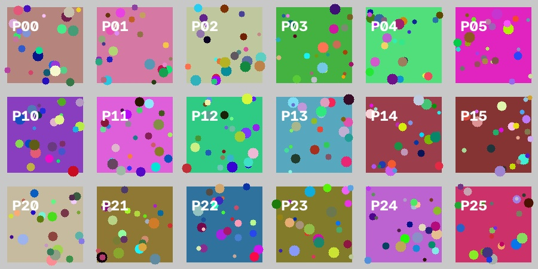
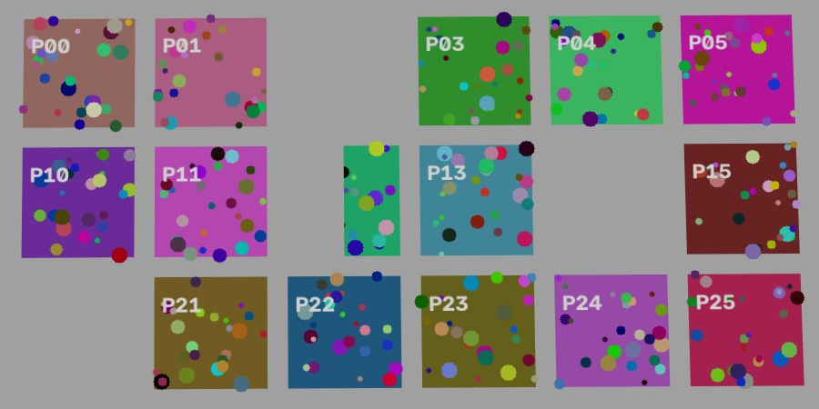
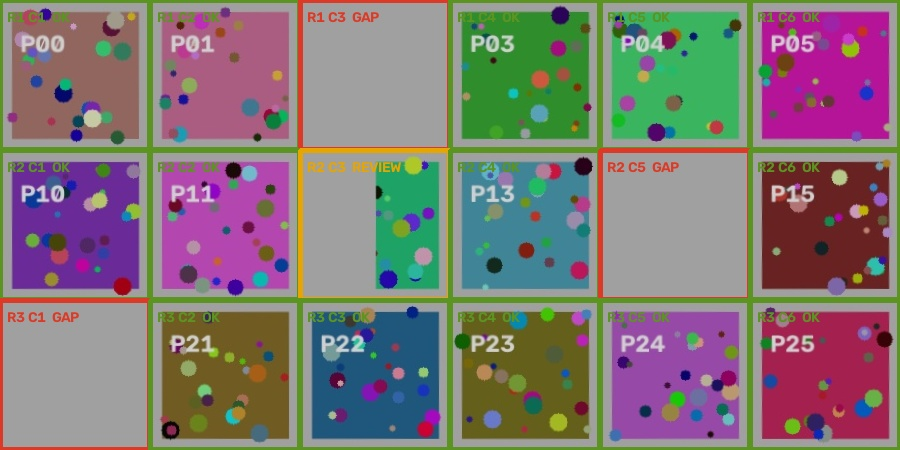

# ShelfWatch Agent

**A visual shelf-checking prototype by Shashwat Shukla, built with OpenCV 5 and FastAPI.**

ShelfWatch compares a current shelf photo with a stocked reference, looks more closely at local changes, and prepares a restock draft for a person to review. The aim is to show where something may have disappeared and why the agent thinks that, rather than producing an unexplained stock count.

Version 2 adds a selectable shelf area, small change-region detection, saved approval records, and access-controlled cloud-demo support. The two real-photo development cases that failed in version 1 now produce the correct affected location. This is progress on known examples, not proof of general retail reliability.

## Start here

**Hosted demo:** [shelfwatch-agent.onrender.com](https://shelfwatch-agent.onrender.com/). Ask the project owner for the demo access code, enter it in **Demo access code**, then click **Try synthetic demo**. The first visit after inactivity may take about a minute. This service runs on Render; AWS delivery is still pending.

You need **Python 3.12**. Extract the whole folder, double-click **`start.bat`** on Windows, and open **http://127.0.0.1:8000/** after the server starts. The first setup installs the pinned packages and needs internet access. Keep the terminal open while using the app; press **Ctrl+C** to stop it.

To run manually in PowerShell:

```powershell
py -3.12 -m venv .venv
.\.venv\Scripts\python.exe -m pip install -r requirements.lock
.\.venv\Scripts\python.exe run.py
```

On macOS/Linux, use `python3.12 -m venv .venv`, then `.venv/bin/python` instead of the Windows executable path in the commands below. No LLM API key or GPU is needed.

## Try a complete example

Click **Try synthetic demo**. Or upload these files:

| Field | File |
| --- | --- |
| Current shelf photo | `samples/current_3_missing.jpg` |
| Full-shelf reference | `samples/reference.jpg` |

| Generated reference | Generated current image |
| --- | --- |
|  |  |



This generated example should find candidate gaps at **row 1 / slot 3**, **row 2 / slot 5**, and **row 3 / slot 1**. **Row 2 / slot 3** needs review. The interface starts row/slot numbers at 1; Python and CSV labels start at 0. These cells are locations, not product quantities.

## Use your own shelf photos

1. Upload a correctly stocked **reference**, then a **current** photo of the same shelf.
2. In **Select the shelf area**, drag a rectangle over the reference shelf. Leave out floor, hands and unrelated background. The percentage fields provide the same control with a keyboard.
3. Choose the reporting rows and slots per row. The grid groups locations; detection works on smaller local regions inside the selected shelf.
4. Click **Analyze shelf** and inspect the marked regions and decision trace.
5. Review the restock suggestion and any amber regions before approving it.

The selected rectangle is in reference-image coordinates. OpenCV aligns the current view to that reference before inspecting it. A photo that does not cover at least 90% of the selected area asks for a retake. Similar camera position and lighting still matter.

Green means no likely removal was found in that reporting cell, red means a candidate gap, and amber means a change needs review. A high alignment ratio only describes feature matching; it is not stock-detection accuracy.

## How the agent decides

1. **Align:** ORB descriptors and a RANSAC homography line up the photos. Poor alignment or insufficient selected-area coverage requests a retake.
2. **Localize:** a robust Lab-color offset compensates for uniform lighting changes. A pixel difference and local reference-texture mask find candidate changes. Morphology and connected components group them into local regions.
3. **Reinspect:** local texture/edge loss and a finer 2×2 cell scan provide more evidence. Small changes can now trigger inspection even when their large reporting cell looks similar overall.
4. **Decide:** likely removal regions create a draft; unresolved changes stay under review. The trace records observations, tools and next actions.
5. **Pause:** a person reviews the draft. Approval is stored in SQLite with an audit event. Repeated approval is rejected. No supplier is contacted and no order is sent.

The workflow is rule based. It does not identify SKUs, count products, call an LLM, or infer certainty from a matching score. Occlusion can look like removal; human review remains necessary.

## What changed after the first real-photo test

Version 1 averaged visual similarity over large fixed cells and missed three removed cans across two public demonstration pairs. It also flagged a smooth background cell incorrectly. Version 2 inspects local changes and uses a reference-texture mask to reduce that background error.

Use **Try real-photo development example** to inspect the first pair in the app. Both source pairs are also included under `samples/external/shelfchange3d/`. They are credited third-party research demonstration photos, not our own store footage.

| Version | Two-can development pair | One-can development pair |
| --- | --- | --- |
| Version 1 | Missed both removals | Missed removal and flagged background |
| Version 2 | Finds two local regions in the correct affected cell | Finds the local region in the correct affected cell |

The known failure report is retained in [the version 1 test notes](docs/external-photo-test.md). Updated evidence is saved separately; development results must not be described as untouched test accuracy.

## Evaluation: keep the datasets separate

The detector settings were recorded before additional examples were inspected. No thresholds were changed to fix the remaining stress-test failure.

| Dataset | Scope | Observed result |
| --- | --- | --- |
| Generated demo | Three simple fixtures | 3/3 expected outcomes; three labelled gap cells found |
| Real-photo development pairs | Two known pairs plus an exact-image control | Correct affected location in both pairs; unchanged control passes |
| Separate generated stress set | 33 cases, three new reference seeds | 32/33 expected outcomes; cell precision **94.7%**, recall **100%**, F1 **97.3%** |
| Additional publisher previews | Three annotated before/after pairs plus unchanged controls | 6/6 coarse diagnostic checks; four manually grouped changed regions matched at IoU ≥0.25; one extra uncertain region |

The stress set covers missing items, partial occlusion, uniform brightness changes, slight viewpoint change, an unrelated scene, a blank image, incomplete shelf coverage, and changes outside the selected shelf area.

**The remaining failure matters:** in `137_partial_occlusion.jpg`, a partly covered item was treated as a candidate gap instead of staying under review. The synthetic metrics do not establish real-store accuracy. The additional publisher previews contain visible annotation boxes, so they are a separate diagnostic, not an uncontaminated raw-photo benchmark. Their grouped regions are not individual product-count labels.

Reproduce the checks:

```powershell
.\.venv\Scripts\python.exe test_pipeline.py
.\.venv\Scripts\python.exe evaluate.py
.\.venv\Scripts\python.exe evaluate.py --labels samples/validation/labels.csv --kind synthetic_stress --output reports/stress.json
.\.venv\Scripts\python.exe evaluate.py --labels samples/holdout/labels.csv --kind annotated_preview --output reports/previews.json
.\.venv\Scripts\python.exe -m unittest discover -s tests -v
```

The stress command intentionally exits with status 1 while that case fails, and still writes every result. The preview command records manual grouped-region diagnostics separately from cell metrics. To regenerate the stress images, run `create_validation_set.py`; this does not regenerate third-party photos.

With the server running, `test_external_photos.py --base-url http://127.0.0.1:8000` repeats the development-photo uploads and writes an illustrated report under `reports/external-photos/`.

Evidence includes source hashes, input hashes, timing, cell labels and decision traces under `docs/evidence/`. These are small reproducible checks, not a representative retail benchmark.

## Storage, access and operation

- Photos are processed in memory and are not stored by the application.
- Drafts and approval events are saved in `.data/shelfwatch.sqlite3`, or the directory set by `SHELFWATCH_STATE_DIR`.
- `SHELFWATCH_TOKEN` enables a demo access code. Set it as a hosting secret, not in source control. The page shows an access-code field when required.
- Public deployment mode (`SHELFWATCH_PUBLIC=1`) refuses to start without a code of at least 24 characters.
- Uploads are capped per image and per request. The service limits concurrent analysis and requests per client.
- `/health` is public and reports OpenCV/runtime readiness. `/orders` and `/metrics` require the code when configured.
- Structured request logs contain request IDs, status and duration, without images or access codes.

SQLite survives an application restart while its storage remains. It does not survive deletion of a container's unmounted filesystem or the AWS demo's state volume. The access code is a lightweight demo guard, not a full multi-user authentication system.

## AWS delivery

The prepared route runs the actual OpenCV/FastAPI container on EC2, with a private S3 source archive, an SSM SecureString, HTTPS, short-retention CloudWatch logs and a state volume. The deployment script stops unless the current account's **ACTIVE FREE plan** and remaining credits are verified. It never upgrades the plan.

Read [the AWS instructions](deploy/aws/README.md). Account activation and billing verification are still required before a live deployment can be claimed. Local setup, deployment code and a Dockerfile alone do not satisfy the hackathon's AWS requirement.

For a local Docker check:

```sh
docker build -t shelfwatch .
docker run --rm -p 8000:8000 -v shelfwatch-state:/data shelfwatch
```

`HOST` and `PORT` configure the server. `.env.example` lists the container settings; the app reads actual environment variables rather than automatically loading that file. Public services need HTTPS and the access code. The Docker image built and ran successfully on Render on October 26, 2026; AWS verification remains outstanding.

## Code map

```text
app.py                         FastAPI routes and upload handling
run.py / start.bat              Start the server
shelfwatch/vision.py            Alignment, ROI, local change detection and overlays
shelfwatch/agent.py             Reinspection decisions and draft generation
shelfwatch/storage.py           SQLite drafts and audit records
shelfwatch/operations.py        Access code, request limits and operational logs
static/                        Browser interactions, selection canvas and styling
templates/                     Interface and external-test report template
samples/                       Demo, stress fixtures and credited external pairs
tests/test_http.py              HTTP safety, selection and approval checks
evaluate.py                    Dataset-specific evaluation
create_validation_set.py       Reproducible stress fixtures
deploy/aws/                    CloudFormation, bootstrap, deployment and cleanup
scripts/package_release.py     Clean archive with SHA-256 manifest
docs/evidence/                 Baseline and updated evidence
```

## Limits and next work

The two development pairs and a generated stress set are a starting point. Store testing needs raw reference/current pairs from varied shelves, manual labels, a separate development split, and a fixed untouched test set. Some new products, rearrangements, glare and occlusion will still confuse appearance-based comparison. Fine change regions may merge nearby products, so the app reports locations rather than stock quantities.

Third-party image sources and reuse notes are in [THIRD_PARTY_NOTICES.md](THIRD_PARTY_NOTICES.md). The [technical report](docs/technical-report.md) records methods, evidence boundaries and remaining delivery steps.

## Render free demo configuration

`render.yaml` explicitly selects Render's **Free** Docker web service in Singapore, with one analysis at a time, one OpenCV worker thread and a 1000-pixel image dimension cap. It does not add a paid database or disk. The host generates a demo access code as a secret; public mode still requires that code for analysis and approvals.

The Free service was deployed and checked on October 26, 2026. Its health endpoint reported OpenCV 5.0.0; authenticated synthetic analysis found three gap cells and one review cell. A credited real-photo development example also returned its expected affected cell. Approval was recorded without sending an order, repeated approval returned 404, and analysis without an access code returned 401. See [the deployment check](docs/evidence/render-verification.json).

Free services can sleep after inactivity, and their local SQLite records are lost when the hosting filesystem resets. This is suitable for a demonstration, not a persistent inventory system. Do not add a payment method or upgrade if keeping a zero-charge demo is required. See https://render.com/docs/free for current limits.

Render hosting does not establish AWS use for the hackathon. A temporary preview from a local computer is also only a preview: its URL stops working when that computer or tunnel process stops. Neither should be described as the verified AWS deployment in the technical report.
